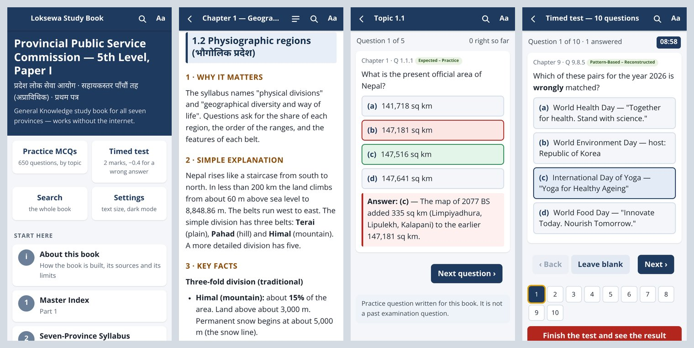

# Loksewa Study Book — Android app

The study book in [`../study-book/`](../study-book/README.md), packed as an Android app that works **without the internet**.

**Ready-made file:** [`release/loksewa-study-book.apk`](release/loksewa-study-book.apk) — about 1 MB.

**To get it on a phone,** open this link in the phone's browser, or scan the picture with the phone's camera:

<https://github.com/gobindsah9841-max/loksewa/raw/arena/2c7939d7-loksewa/android-app/release/loksewa-study-book.apk>


The exact build details are in [`release/BUILD-INFO.md`](release/BUILD-INFO.md).



*The picture was made in a desktop browser set to the size of a phone screen. It is not a photo of a phone.*

> **Read this first.** The app was built and checked on a build server that has no Android phone and no emulator.
> The file is correctly formed and correctly signed, and its pages were tested in a real browser engine.
> But **nobody has yet installed it on a phone.** Please try it and report anything that is wrong.
> The full list of what was and was not checked is in section 5.

---

## 1. What the app is

- One small app, called **Loksewa Book** on the home screen.
- It holds the whole study book and all its questions inside the file. Nothing is downloaded later.
- It asks for **no permission** — not even internet access. On its own it cannot send or fetch anything.
  Only when you tap a source link does it ask your browser to open that web page.
- Your reading position and your scores are saved only on your phone.

## 2. How to install it

1. Get `loksewa-study-book.apk` onto the phone. Easiest: open the link at the top of this page in the phone's browser.
   Or copy the file by USB cable, Bluetooth or Google Drive, or send it as a *document* in a chat app.
   (Gmail does not accept `.apk` files.)
2. Open the file from the **Files** or **Downloads** app.
3. Android will say that this source is not allowed to install apps. Tap **Settings**, turn on **Allow from this source**, and go back.
   (On Android 7 and older: **Settings → Security → Unknown sources**.)
4. Tap **Install**.
5. Google Play Protect may warn that it does not know the developer. That is expected: this app is not from the Play Store.
   Choose **Install anyway** (sometimes under **More details**).
6. Open **Loksewa Book**.

**Samsung phones:** if *Auto Blocker* stops the install, turn it off in **Settings → Security and privacy → Auto Blocker**,
install the app, and turn it on again. Other makers may show their own extra warning; accept it and continue.

**To update later:** install the new file over the old one. Your scores stay.
If Android says *App not installed*, remove the old app first and install again (the scores are then lost).

**A rule that is coming.** Google now asks app makers to register their identity. Since 30 September 2026 this applies in
Brazil, Indonesia, Singapore and Thailand, and Google has said it will apply everywhere from 2027. This app is signed with a
home-made key that is not registered. When the rule reaches Nepal, installing the file may need extra steps on the phone.
Source: <https://android-developers.googleblog.com/2026/06/android-developer-verification.html>

## 3. What the app does

| Screen | What you can do |
|---|---|
| **Read** | Read any Part or Chapter. A contents list jumps to a topic. Answers stay hidden until you tap them. The app remembers where you stopped. |
| **Practice MCQs** | Answer the questions of one topic, of a whole chapter, or only the ones you got wrong. The answer and a short explanation appear at once. |
| **Timed test** | 10, 25 or 50 mixed questions with a clock (54 seconds a question, as in the real paper). Marked as in the examination: 2 marks for a right answer, 0.4 mark off for a wrong one, nothing for a blank. A test left by mistake can be resumed while the app stays open. |
| **Search** | Find a word anywhere in the book, in English or in Nepali. |
| **Settings** | Five text sizes; light, sepia and dark colours; erase the saved scores. |

Every question keeps the label it has in the book. All of them are practice questions written for the book.
**None is presented as a past examination question.**

## 4. What is in this version

The app holds exactly what is in `study-book/` on the day it is built. `release/BUILD-INFO.md` gives the numbers.

Version 1.13 (12 November 2026) holds **Parts 1–13: the four front Parts and Chapters 1–9, with 650 MCQs and
130 short-answer questions.** The first build, version 1.12, stopped at Chapter 8. The province chapters and the
mental-ability chapter are not written yet, so the timed test has General Knowledge questions only.

The facts are as dated in each chapter. The app does not update itself: build it again after the book changes.

## 5. What was checked, and what was not

**Checked on the build server**

| Check | Tool | Result |
|---|---|---|
| The signature is valid for Android 5.0 and newer (schemes v1, v2, v3) | `apksigner verify` | passes |
| Android's own tool can read the app's name, version, start screen and icon | `aapt2 dump badging` | passes |
| The app asks for no permission | read from the finished file | none |
| The program code holds only the app's own 8 small classes | read from `classes.dex` | passes — listed in `BUILD-INFO.md` |
| Files stored without compression are placed as Android requires | built-in check | passes |
| The pages behave correctly: reading, hidden answers, practice, scoring, timed test, search, settings | `tools/test_ui.js` (55 checks, simulated browser) | all pass |
| The pages work when opened from storage with no server, as inside the app; nothing is wider than a phone screen; progress survives closing; Back never gets stuck; a test left by mistake can be resumed | `tools/browser_check.sh` (headless Chromium 153, every screen, 16 checks) | all pass |

**Not checked**

- **Installing and running on a real phone or an emulator.** None was available. The small Java part that shows the pages
  (`MainActivity.java`, about 100 lines) compiles and was inspected, but it has never run.
- Old phones whose "Android System WebView" was never updated. The pages use only old, widely supported features, but this was not tried.
- How the Nepali letters and the marks 🔄 ⚖️ ✅ look on your phone. They use the phone's own fonts.

## 6. Build it again

Needs Linux (x86-64), `python3` with `pip`, and `git`. Tested only there.

```bash
bash android-app/tools/fetch_toolchain.sh     # once: fetches the build tools (about 170 MB) into /tmp/loksewa-apk-toolchain
python3 android-app/build_apk.py              # every time the book changes; takes a few seconds
```

The new file replaces `android-app/release/loksewa-study-book.apk`, and `BUILD-INFO.md` is rewritten.

Optional checks (need `node` and `npm`; fetch about 170 MB more):

```bash
bash android-app/tools/browser_check.sh       # runs both page tests and remakes release/preview.jpg
```

Useful options: `python3 android-app/build_apk.py --help`.
The version name is `1.` followed by the number of the last Part in the book (Parts 1–12 give version 1.12).

## 7. How it is built without the Android SDK

The build server could reach only GitHub, PyPI and npm — not Google's or Maven's download servers.
So the usual tools (Android Studio, Gradle, the SDK) could not be installed. `build_apk.py` does by hand what they do:

| Step | Tool | Where `fetch_toolchain.sh` gets it |
|---|---|---|
| Markdown → pages and question data | `tools/make_assets.py` with `markdown-it-py` | PyPI |
| Launcher icon | `tools/make_icons.py` with `Pillow` | PyPI |
| Pack resources and the manifest | `aapt2` 2.19 | PyPI package `aapt2` 0.2.1 |
| Run the Java tools | Temurin Java 25 runtime (with `keytool`) | PyPI package `jdk4py` 25.0.2.1 |
| Android programming interface, level 34 | `android.jar` | GitHub `Sable/android-platforms` |
| Compile Java | Eclipse compiler `ecj` 4.2.2 | GitHub `jvf/scalaris` (a Tomcat copy) |
| Convert to Android's `classes.dex` | `dx` 1.16 (file `dx-30.0.2.jar`) | GitHub `oooooooko/kmpact` |
| Zip, with 4-byte alignment | Python, in `build_apk.py` | — |
| Sign and verify | `apksigner` (file `apksigner-36.0.0.jar`) | GitHub `oooooooko/kmpact` |

**How far to trust these tools.** They are copies kept by other people, not downloads from Google, Eclipse or Maven.
They could not be compared with the official files on the build server. Two things limit the risk: the finished app is checked to hold
no code but its own 8 classes, and it has no permission to use the network or your files. If you want to be sure,
compare the checksums below with official copies, or point the build at your own tools.

SHA-256 of the files used for the first build:

```
6cea1df3efb77103ac3e2beb9bf4718964b0e0869ab16d39d29d5cbae1c147ad  android.jar
4c74df88610d673b2c74bf5b48b6284bae42f9b880f0ad89a8ada69fe84a0d70  ecj.jar
5f37023cdab507f4f2ece1c80dabd056254e30cc9f4aef39dd84c4e0a0031615  dx.jar
3716d9311e55d2b0918a2fd9d54ba9e406c5f6abeea700b287f11259bc163dec  apksigner.jar
1cf3df7b8a2e8d3d8c42f5401d9af4549de79efee05b0e6e8e9f26582aff2bab  aapt2
```

**Using your own tools (not tried here).** Every tool path can be replaced with an environment variable:
`JAVA`, `KEYTOOL`, `AAPT2`, `ANDROID_JAR`, `ECJ`, `DX`, `APKSIGNER`. With a normal Android SDK, for example:

```bash
AAPT2=$ANDROID_HOME/build-tools/34.0.0/aapt2 \
ANDROID_JAR=$ANDROID_HOME/platforms/android-34/android.jar \
APKSIGNER=$ANDROID_HOME/build-tools/34.0.0/lib/apksigner.jar \
python3 android-app/build_apk.py
```

The Java source is written in plain Java 7 because that is the newest level the old `ecj` understands.

## 8. The signing key

Android accepts an update only if it is signed with the same key as the installed app.

- The build makes a **home-made test key** the first time it runs: `signing/loksewa-debug.p12` (alias `loksewa`).
  It proves only that two files came from the same key — not who made them.
- **The key file is not uploaded to GitHub.** It stays on the machine where the published file was built.
  Anyone who holds the key can sign a file that phones would accept as an update of this app, so keep it private
  and never add `signing/` to the repository.
- If you build the app yourself from this repository, the build makes a new key for you. Your file works, but it
  cannot be installed over the published one: remove the old app first (its saved scores are then lost).
  The same happens to the next published version if the original key is ever lost.
- Before giving the app to many people, make a key with a strong password and keep it safe:

```bash
keytool -genkeypair -keystore my-release.p12 -storetype PKCS12 -alias loksewa -keyalg RSA -keysize 2048 -validity 10950
```

  Then change `KEYSTORE`, `KEY_ALIAS` and `KEY_PASS` near the top of `build_apk.py`.
  People who installed the test-key build must remove it once before installing the new one.
- The Play Store needs more than this file: a developer account, an app bundle (`.aab`), and its own review.

## 9. Folder map

```
android-app/
├── README.md                 this page
├── build_apk.py              the whole build, start to finish
├── app/
│   ├── AndroidManifest.xml   name, version limits, start screen; no permissions
│   ├── java/…/MainActivity.java   shows the pages; sends web links to the phone's browser
│   ├── res/values/           app name, colours, theme
│   └── web/                  the reader itself: index.html, app.css, app.js (no outside libraries)
├── tools/
│   ├── fetch_toolchain.sh    gets the build tools
│   ├── make_assets.py        book → pages, questions, search index
│   ├── make_icons.py         draws the launcher icon
│   ├── check_chapter.py      checks that a chapter of the book follows the fixed layout
│   ├── test_ui.js            55 behaviour checks (jsdom)
│   ├── browser_check.mjs     walk through every screen in headless Chromium
│   └── browser_check.sh      installs what the two tests need and runs them
├── signing/                  the test signing key lives here on the build machine; not uploaded (section 8)
└── release/
    ├── loksewa-study-book.apk   the app
    ├── BUILD-INFO.md            version, size, checksums, what is inside
    ├── preview.jpg              four screens
    ├── download-qr.png          the download link as a QR code
    └── icon-preview.png         the launcher icon
```

The book itself is not copied into this folder. The build reads `../study-book/README.md` and every `part-*.md` file, in order.
Files in `study-book/_build/` (unfinished drafts) are left out.

## 10. Limits you should know

- The app is a reader. It does not fetch news or update the 🔄 facts; the book's dates apply.
- Scores live in the app's storage. Removing the app, or clearing its data, erases them.
- The timed test draws only from the chapters written so far and has no mental-ability questions yet.
- The web application in `../src/` (Next.js with a database) is a different thing and is **not** inside this app.
  It needs a server, so it cannot be packed into a stand-alone file like this one.
